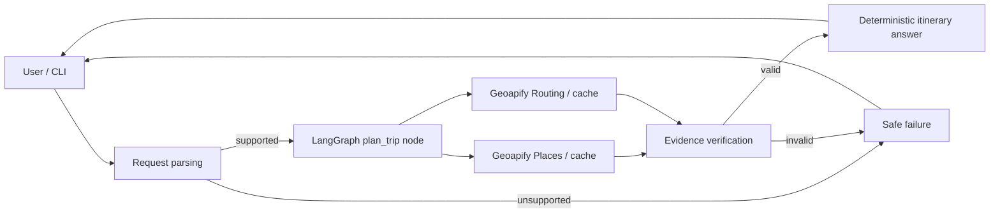

# Travel AI Agent — Technical Walkthrough

## Problem and goal

Build a command-line travel-planning agent that can incorporate explicit user preferences, query real geographic points of interest, and present source-linked candidate itineraries without inventing business hours, prices or walking times.

## Main implementation

- **Provider-based LLM tool calling:** the original `travel_agent.cli` has a tool loop; DeepSeek and Gemini can be configured as primary/backup. A mocked Gemini-503 failover scenario passed automated testing, but that does not prove real-world provider uptime.
- **Real POI retrieval:** Stage 4/5 uses Geoapify Places (including cached results) to retrieve Melbourne-area points, coordinates, addresses and OSM entity URLs.
- **Walking route estimates:** Geoapify Routing supplies route distances and approximate durations where available. Routes are estimates, not real-time transit or walking conditions.
- **Graph orchestration:** `travel_agent.graph_flow` uses LangGraph `StateGraph` nodes `parse → plan_trip → verify → answer`, with a safe error branch for invalid input, tool failure or insufficient data.
- **Grounded answer:** factual place/route content is formatted deterministically from verified tool data. A model may provide an optional short, non-factual introduction.
- **Local preferences and observability:** explicit user preferences persist across demo sessions and are separated by supplied user ID; JSONL trace events record run/step status and durations.
- **Tests:** the suite includes unit/logic checks for tool behavior, model fallback, map responses, memory, trace, itinerary planning and graph error cases.

## Architecture



## Reproduce

```bash
python -m unittest discover -s tests -v
TRAVEL_MAP_PROVIDER=geoapify TRAVEL_DATA_MODE=osm python -m travel_agent.graph_cli --user-id demo_user --session-id graph1
TRAVEL_MAP_PROVIDER=geoapify TRAVEL_DATA_MODE=osm python eval_travel_stage7.py --live
```

The evaluation entry point disables the optional model greeting to isolate tool-backed itinerary evaluation.

## Boundaries and future work

The CLI is a portfolio prototype, **not** a booking or authentication system. Supplying another `user_id` is not proof of identity. Missing: real-time fares/opening hours, booking, external rate-limited production gateway, robust concurrent session storage, cross-city generalization, user studies and broader regression/evaluation datasets.
